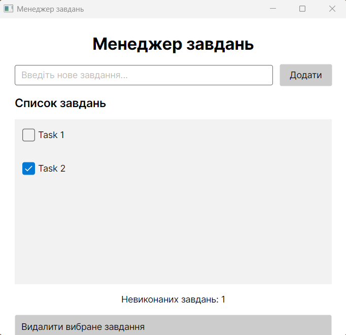

# Фото працюючої програми

---
# Відповіді на контрольні запитання
## 1. Що означає кросплатформність програмного забезпечення?
Кросплатформність означає можливість запускати програму на різних операційних системах без необхідності повністю переписувати її код. Наприклад, застосунок на Avalonia може працювати на Windows, Linux та macOS.
## 2. Для чого використовується Avalonia UI?
Avalonia UI — це кросплатформний фреймворк для створення графічних застосунків на C# та .NET. Він дозволяє створювати вікна, кнопки, текстові поля, списки та інші елементи інтерфейсу.
## 3. Чим Avalonia UI відрізняється від Windows Forms?
Windows Forms призначений переважно для створення Windows-застосунків. Avalonia UI підтримує декілька операційних систем. Також Avalonia використовує XAML для опису інтерфейсу та має власний механізм відображення графічних елементів.
## 4. Як у C# обробляються події елементів графічного інтерфейсу?
Для обробки подій використовуються методи-обробники, які підписуються на відповідні події елементів інтерфейсу. Наприклад, для кнопки можна використати подію Click. Коли користувач натискає кнопку, викликається відповідний метод.
## 5. Яким чином можна відокремити логіку застосунку від графічного інтерфейсу?
Для цього можна використовувати архітектурні підходи MVC або MVVM. Наприклад, у MVVM інтерфейс відповідає за відображення даних, ViewModel — за логіку взаємодії, а Model — за зберігання та структуру даних. Це спрощує тестування та підтримку програми.

