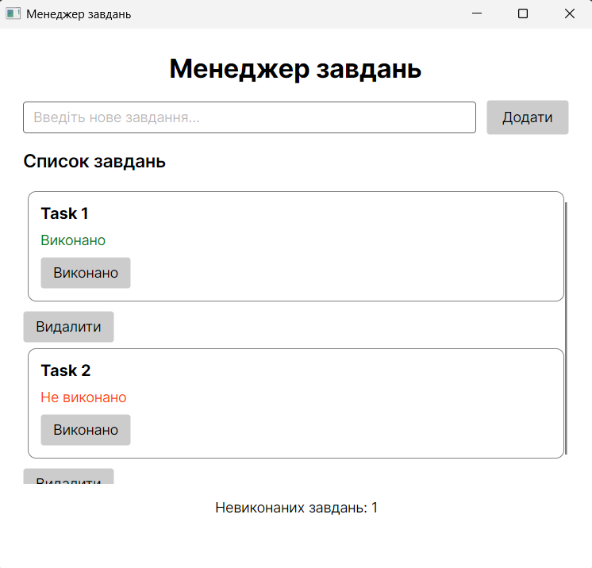

# Скріншот робочої програми

# Питання

### 1. Які два компоненти Avalonia UI ви створили та яку роль вони виконують?

Я створив два компоненти: `TaskCard` та `TaskActionButton`.

`TaskCard` використовується для відображення одного завдання, його назви та статусу виконання.

`TaskActionButton` — це універсальна кнопка, яку можна налаштувати для різних дій, наприклад виконання або видалення завдання.

### 2. Які дані передаються до компонентів через властивості або прив'язку?

До `TaskCard` через DataContext передається об'єкт `TodoItem`, який містить назву та статус завдання.

До `TaskActionButton` передаються текст кнопки через `ButtonText` та об'єкт завдання через `Parameter`.

### 3. Як дія з компонента змінює стан завдання в основному застосунку?

Компоненти використовують власні події для взаємодії з головним вікном.

Під час натискання кнопки в `TaskCard` змінюється властивість `IsCompleted`. Під час натискання кнопки видалення головне вікно отримує об'єкт через `Parameter` та видаляє його з колекції.

### 4. Де в коді видно повторне використання компонентів без дублювання?

Повторне використання видно у файлі `MainWindow.axaml`. Компонент `TaskCard` використовується всередині `ItemsControl.ItemTemplate`.

Завдяки цьому для кожного завдання автоматично створюється окрема картка. `TaskActionButton` також використовується для різних дій без створення окремих компонентів.